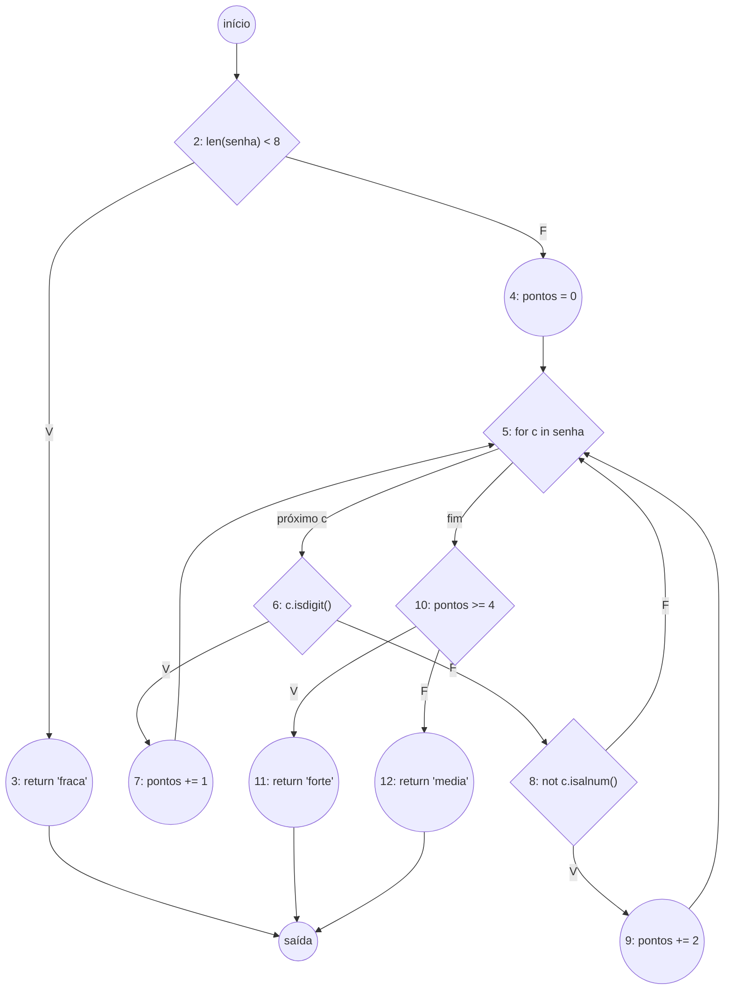

# Exercício 1 — Força da Senha

## a) GFC e V(G)

Cada nó é identificado pelo número da linha. O nó `X` é a saída única, para onde
convergem os três `return`.



Contando só os nós 2 a 12 e `X` (o nó `início` é apenas o rótulo de entrada e
coincide com o nó 2):

- **Nós (N):** 2, 3, 4, 5, 6, 7, 8, 9, 10, 11, 12, X $\rightarrow$ **N = 12**
- **Arestas (E):** 2$\rightarrow$3, 2$\rightarrow$4, 4$\rightarrow$5, 5$\rightarrow$6, 5$\rightarrow$10, 6$\rightarrow$7, 6$\rightarrow$8, 7$\rightarrow$5, 8$\rightarrow$9, 8$\rightarrow$5, 9$\rightarrow$5,
  10$\rightarrow$11, 10$\rightarrow$12, 3$\rightarrow$X, 11$\rightarrow$X, 12$\rightarrow$X $\rightarrow$ **E = 16**
- **Predicados (P):** nós 2, 5, 6, 8 e 10 $\rightarrow$ **P = 5**

| Fórmula          | Cálculo     | V(G)  |
| ---------------- | ----------- | ----- |
| V(G) = E − N + 2 | 16 − 12 + 2 | **6** |
| V(G) = P + 1     | 5 + 1       | **6** |

## b) Base de caminhos

Método da linha de base: escolhe-se um caminho e, a cada novo caminho, inverte-se
**uma** decisão ainda não invertida. Cada caminho passa por pelo menos uma aresta
que nenhum anterior percorreu, por isso o conjunto é linearmente independente.

| Caminho   | Sequência de nós                        | Entrada      | Saída esperada | Aresta nova (justificativa)                                              |
| --------- | --------------------------------------- | ------------ | -------------- | ------------------------------------------------------------------------ |
| P1        | 2 $\rightarrow$ 3 $\rightarrow$ X                               | `"abc"`      | `"fraca"`      | 2$\rightarrow$3, 3$\rightarrow$X: inverte a decisão 2                                            |
| P2        | 2 $\rightarrow$ 4 $\rightarrow$ 5 $\rightarrow$ 10 $\rightarrow$ 12 $\rightarrow$ X                 | —            | —              | 5$\rightarrow$10 logo após 4: inverte a decisão 5 (laço com 0 voltas) — **inviável** |
| P3 (base) | 2 $\rightarrow$ 4 $\rightarrow$ 5 $\rightarrow$ 6 $\rightarrow$ 8 $\rightarrow$ 5 $\rightarrow$ 10 $\rightarrow$ 12 $\rightarrow$ X     | `"abcdefgh"` | `"media"`      | 2$\rightarrow$4, 4$\rightarrow$5, 5$\rightarrow$6, 6$\rightarrow$8, 8$\rightarrow$5, 5$\rightarrow$10, 10$\rightarrow$12, 12$\rightarrow$X                               |
| P4        | 2 $\rightarrow$ 4 $\rightarrow$ 5 $\rightarrow$ 6 $\rightarrow$ 7 $\rightarrow$ 5 $\rightarrow$ 10 $\rightarrow$ 12 $\rightarrow$ X     | `"abcdefg1"` | `"media"`      | 6$\rightarrow$7, 7$\rightarrow$5: inverte a decisão 6                                            |
| P5        | 2 $\rightarrow$ 4 $\rightarrow$ 5 $\rightarrow$ 6 $\rightarrow$ 8 $\rightarrow$ 9 $\rightarrow$ 5 $\rightarrow$ 10 $\rightarrow$ 12 $\rightarrow$ X | `"abcdefg!"` | `"media"`      | 8$\rightarrow$9, 9$\rightarrow$5: inverte a decisão 8                                            |
| P6        | 2 $\rightarrow$ 4 $\rightarrow$ 5 $\rightarrow$ 6 $\rightarrow$ 8 $\rightarrow$ 9 $\rightarrow$ 5 $\rightarrow$ 10 $\rightarrow$ 11 $\rightarrow$ X | `"abcdef!!"` | `"forte"`      | 10$\rightarrow$11, 11$\rightarrow$X: inverte a decisão 10                                        |

> Nas entradas concretas o laço dá várias voltas (uma por caractere); a tabela
> mostra a volta que distingue o caminho, as demais são letras (6 F $\rightarrow$ 8 F $\rightarrow$ 5).

**Caminho inviável: P2.** Ele exige sair da decisão 2 pelo F (`len(senha) >= 8`)
e, em seguida, sair do `for` sem nenhuma volta. Só que o `for` dá exatamente
`len(senha)` voltas; se chegou ao laço, a senha tem pelo menos 8 caracteres, então
o laço dá **no mínimo 8 voltas**. Pelo mesmo motivo é impossível chegar a `"forte"`
sem entrar no laço. Logo, dos 6 caminhos da base, **5 são viáveis**.

## c) Testes com `parametrize` e cobertura

`test_senha.py::test_caminhos_base` implementa P1, P3, P4, P5 e P6.

```
$ pytest -q -k caminhos_base --cov=senha --cov-branch --cov-report=term-missing
Name       Stmts   Miss Branch BrPart  Cover   Missing
------------------------------------------------------
senha.py      12      0     10      0   100%
5 passed
```

- Os **5 testes viáveis** já dão **100% de comandos e ramos**, contra V(G) = 6:
  o caminho que faltaria é justamente o inviável.
- Cobertura de ramos exige ainda menos: **3 testes** bastam, por exemplo
  `"abc"` (fraca), `"abcdefgh"` (media) e `"a1!!xyzw"` (forte, que passa por
  dígito, símbolo e letra no mesmo laço). Também deu 100% ao medir.
- Ou seja: V(G) é um **limite superior** para cobertura de ramos e o tamanho da
  base, mas não é o número de testes viáveis nem o mínimo para 100% de ramos.

## d) Teste de laços

O `for` dá `len(senha)` voltas. Como senhas com menos de 8 caracteres saem na
linha 3, o laço só é executado com **8 ou mais voltas, sem limite superior**.

Os casos clássicos de laço simples (0, 1, 2, m, n−1, n, n+1 voltas) ficam assim:

| Caso clássico | Faz sentido? | Caso usado |
| ------------- | ------------ | ---------- |
| 0 voltas (pular o laço) | Não, inviável (item b) | — |
| 1 e 2 voltas | Não, inviáveis (len < 8 sai antes) | — |
| Logo abaixo do mínimo | Sim, confirma a fronteira | `"abcdefg"` (7 caracteres) $\rightarrow$ `"fraca"` |
| Mínimo (8 voltas) | Sim | `"12345678"` $\rightarrow$ `"forte"` |
| Mínimo + 1 (9 voltas) | Sim | `"abcdefgh1"` $\rightarrow$ `"media"` |
| Número típico (m) | Sim | `"abc123!xyz"` (10 voltas) $\rightarrow$ `"forte"` |
| Máximo n, n−1, n+1 | Não há máximo; substituído por "muitas voltas" | `"a" * 999 + "1"` (1000 voltas) $\rightarrow$ `"media"`, `"abcdefg" + "!" * 1000` $\rightarrow$ `"forte"` |

Também foram incluídas as fronteiras do acumulador dentro do laço, já que é ele
que decide a saída na linha 10:

- `"abcde123"` $\rightarrow$ 3 pontos $\rightarrow$ `"media"`
- `"abcd1234"` $\rightarrow$ 4 pontos $\rightarrow$ `"forte"`

Esses casos estão em `test_senha.py::test_lacos`. Suíte completa:

```
$ pytest -q --cov=senha --cov-branch --cov-report=term-missing
senha.py      12      0     10      0   100%
13 passed
```
